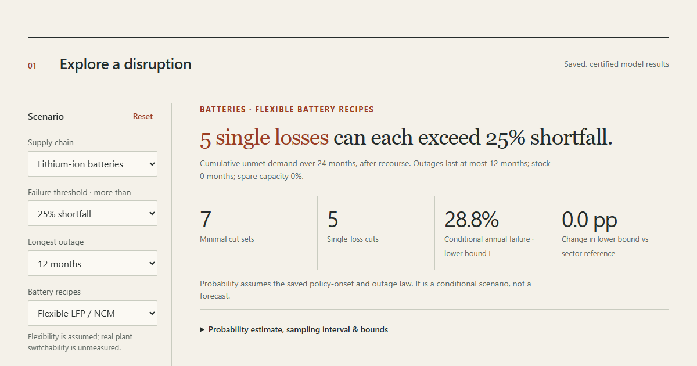

# Supply Chain Cuts

**Explorer: https://symonyeal.github.io/Supply-Chain-Cuts/**



## Explore the results

The explorer compares certified battery, solar and shared-network disruption scenarios.
Choose the shortfall threshold, maximum outage, battery recipes, input stock and spare
capacity. Pin a scenario to compare it with another, share its URL, filter the minimal
cut sets, inspect their shorter-outage checks, and download the displayed cuts or nodes.
Unavailable shared-network settings are disabled; the browser selects saved results
without interpolating or solving a new optimisation.

The mineral view adds 240 USGS production observations for 2024–2025 and 16 IEA refining
concentration observations for 2025. It preserves estimates, withheld values, country
aggregates and rounded world totals. These newer observations are context: the historical
model capacities, policy rates and certified result bundles retain their original inputs.
[Definitions and limitations](docs/CONTEXT-DATA.md) explain the distinction.

The page uses local HTML, CSS and JavaScript with no runtime library or font downloads.
The [full research tables](https://symonyeal.github.io/Supply-Chain-Cuts/research.html)
retain the severity study, registered hypotheses, natural-hazard scenarios and detailed
reference results. That technical appendix uses Plotly from its existing pinned CDN URL.

## In plain terms

The batteries in phones and electric cars, and solar panels, pass through a long chain of
mines, chemical refineries, component factories and assembly plants spread across many
countries. This project asks which losses would cut world production by a quarter or more
over two years. A loss here means one country's output of one product, alone or together
with up to two others. It also asks how often that might happen.

**What we found.**

- **Batteries:** there are five single weak points, all in China. A year-long loss of
  China's battery cells, cathode material, anode material, graphite or lithium carbonate
  would each, on its own, cause that shortfall. This assumes factories can switch between
  the two main battery recipes (LFP and NCM). If they cannot, China's refined cobalt and a
  cathode precursor become weak points too.
- **Solar:** there are four single weak points, again all in China: polysilicon, wafers,
  cells and modules.
- **How likely:** in a stress test that treats every export restriction recorded since 2012
  as a complete shutdown, such a shortfall happens in about 29% of years for batteries and
  24% for solar. These are what-if numbers, not forecasts. Real restrictions are rarely
  total, and the recorded history does not predict them well.

**What this does not show.** Much capacity outside China is estimated from export volumes,
because production figures are missing. No factory locations are modelled, so natural
disasters are not covered. Nothing here is investment advice.

The rest of this page is written for specialists.

## Answer

**Five Chinese single losses remain when the model may choose LFP or NCM recipes:**
cells, cathode material, anode material, graphite and lithium carbonate, each out for a
year. There are seven minimal cuts of at most three losses at a 25% shortfall threshold
over 24 months. China’s precursor and refined-cobalt singletons disappear; all 29 former
cobalt or precursor cuts have zero shortfall. This assumes recipe flexibility at fixed
reference capacities; actual plant switchability is unmeasured. The fixed 50/50
reference retains its original 37 cuts and seven singletons for comparison.

**Probability remains a scenario.** Under the same full-outage onset law, chemistry
choice gives Li-ion L = 0.288286 and lower bound plus residual 0.288286 (95% sampling
interval 0.288286–0.288471), versus 0.485681 for the fixed mix. The approved export
severity study yields only four isolated events and no identified measure effect;
its declared full-loss fallback therefore leaves the reference scenario unchanged.
Recorded onsets fail the predictive test. These are conditional probabilities, not forecasts.

**Solar has four Chinese singleton cuts and 22 cuts in all.** With chemistry choice,
the shared network has 100 cuts and no singletons at 25%, L = 0.105885 and estimate
0.106885 (95% sampling interval 0.106496–0.107429). A fresh independent reconstruction
reproduces all 22 solar and 180 fixed-mix shared cuts from raw inputs.

**New capacity data matter.** The METI Japan supplement (assumed voltage, imputed)
removes the trade-dependent cell triple, leaving six choice cuts and the same five
singletons. A German sold-carbonate proxy changes no headline cut. The registered
competing-demand sensitivity exposes baseline failures under some allocations;
it is reported without reducing demand to hide them.

**What the data cannot show.** Most non-China cell and refined-nickel capacity still
rests on export mass; precursor is imputed; country-specific competing demand is unknown;
a recorded policy measure is not an observed outage; no production site has located
capacity, so natural hazards are a scenario. Details: [FINDINGS](docs/FINDINGS.md).

## Model

The supply chain is a capacity network from mine to refined chemical to cell, built from
2024 production statistics where they exist and export mass where they do not; every node
is labelled `production`, `trade` or `imputed` ([DATA](docs/DATA.md)). Let z be a
disruption state: each node out for 0, 3, 6 or 12 months. With shipments rerouted,
inventory drawn and spare capacity ramped, the least cumulative shortfall over 24 months is

```
φ(z) = min Σ_t g_t   s.t.  y ≤ ū(z),  shipments ≤ output,  inventory balance,  Σ y_cell + g ≥ d,
```

and production fails when φ(z) > α Σ_t d_t. A cut set is a minimal failing state. Cut sets of
up to three losses are enumerated exactly, three ways that share no code: an interdiction
MILP built from the LP dual, a lattice search pruned by capacity dominance, and exhaustive
search; their lists agree wherever all three ran ([MODEL](docs/MODEL.md),
[VALIDATION](docs/VALIDATION.md)). The annual probability is bracketed,
L ≤ P(fail) ≤ min(1, L + P(more than three losses)), with L exact. The estimate adds to L
a Monte Carlo estimate of failures containing no enumerated cut. It cannot fall below L;
its binomial interval stays informative with zero observed residuals. Legacy importance
sampling and crude MC remain comparisons. The law uses export-policy onsets 2012–2024
([HYPOTHESES](docs/HYPOTHESES.md),
[FINDINGS](docs/FINDINGS.md)).

| Model | Module | Source |
| --- | --- | --- |
| Native recourse LP φ(z), exact blocks | `crates/sc-model`; Python oracle: `chokepoint/recourse.py` | Brown et al. 2006; Snyder et al. 2016 |
| Native lattice cut enumeration | `crates/supply/src/cuts.rs`; independent Python enumeration: `chokepoint/brute.py` | Lemma B, docs/MODEL.md |
| Historical interdiction MILP | `chokepoint/cuts.py` | Wood 1993; Israeli & Wood 2002 |
| Native network and bill of materials | `crates/sc-data`; Python oracle: `chokepoint/net.py`, `chokepoint/bom.py` | USGS, MIIT, Cochilco, CEPII BACI; Xu et al. 2020 |
| Historical policy-onset calibration | `chokepoint/events.py`, `chokepoint/rates.py`; native runs take an explicit frozen law | OECD Inventory of Export Restrictions |
| Native bracket and residual MC | `crates/cut-risk`, `crates/supply/src/risk.rs`; Python oracle and historical importance sampling: `chokepoint/risk.py` | MODEL §Annual probability; Clopper & Pearson 1934 |

## Reproduce

Build and run the native Rust pipeline from the repository root. Building requires
the pinned Rust toolchain, CMake and a C++ compiler for the vendored HiGHS solver.

```text
cargo build --release --locked -p supply
target/release/supply verify
target/release/supply build
target/release/supply serve
```

Use `supply.exe` on Windows. Open `http://127.0.0.1:8000/` after `serve` starts.
`build` verifies source hashes and rebuilds the explorer model payload and observational
context directly in Rust. Native `network`, `evaluate`, `cuts`, `risk` and `run` commands
compute new scenarios; they do not launch Python. Risk requires an explicit frozen
onset law. Time-limited searches report incomplete results and cannot certify a risk
upper bound. [Rust commands and measured scope](docs/RUST.md) document configuration,
certificates and the remaining limits.

Python is the independent comparison oracle and retains the historical calibration,
severity and importance-sampling tools. The original reproduction commands remain:

```text
python -m pytest -q                               # fast gate; -m slow for the long tests
python run_data.py RUN                            # networks and reconciliations
python run_cuts.py RUN 7 [liion|pv|joint]         # cut sweep with certificates
python run_risk.py RUN                            # rates, bracket, estimates, tests
python run_chemistry.py RUN 7                     # recipe-choice cut sweep
python run_chemistry_risk.py CUT_RUN OUT_RUN       # frozen-law recipe-choice risk
python run_severity.py RUN                        # registered trade responses and loss scenarios
python analysis/build_site.py LIION_RUN PV_RUN JOINT_RUN SEVERITY_RUN  # generated site/data.js
python analysis/check_residual.py BEFORE AFTER    # unchanged legacy results and W1 checks
python analysis/build_context.py                  # hash-check and rebuild context JS/CSV offline
```

Install the pinned numerical dependencies with `python -m pip install -r requirements.txt`.
Browser verification additionally needs
`python -m pip install -r requirements-browser.txt` and
`python -m playwright install chromium`; run
`python analysis/check_explorer.py --out evidence/browser`.

The native recourse comparison covers 192 cases and 5,962 states at the reference
24-month horizon; all 23,848 compared numerical fields match the Python oracle bit
for bit. The explorer payload matches at every one of 90,912 JSON nodes, before and
after presentation rounding. Other horizons are unmeasured, and stock coverage is
limited to the documented test cases. CI runs numerical and browser checks; Pages
deploys the successful checked revision.

The Python oracle uses Python 3.14 with numpy and scipy (HiGHS).
Raw inputs are frozen in `data/` with URL,
date, SHA-256 and licence in `SOURCES.lock`; sources whose licence is unverified stay out
of git and are re-fetchable by URL. `site/data.js` is generated by `supply build`
from the committed bundles in `results/`. No investment or price claim is made.
Published W1 bundles: `liion-residual-2395a5c`, `pv-residual-2395a5c`,
`joint-residual-2395a5c`; their predecessor bundles remain immutable.
The approved severity study (`severity-26ebd48`) retains only four isolated events and
identifies no measure-type loss fraction. Its declared full-loss fallbacks leave the
scenario law unchanged. The site shows this identification failure beside the full-outage
and quota/ban scenarios; no measured production loss or calibrated forecast is claimed.
