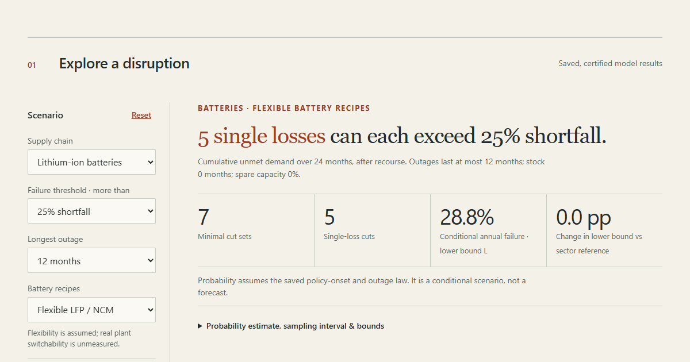

# Supply Chain Cuts

Explorer: https://symonyeal.github.io/Supply-Chain-Cuts/



Results are on the site and in [docs/FINDINGS.md](docs/FINDINGS.md).

- [Overview](https://symonyeal.github.io/Supply-Chain-Cuts/): findings in plain language.
- [Scenario explorer](https://symonyeal.github.io/Supply-Chain-Cuts/explore.html): certified battery, solar and shared-network disruption scenarios.
- [Research tables](https://symonyeal.github.io/Supply-Chain-Cuts/research.html): the severity study, registered hypotheses, natural-hazard scenarios and detailed reference results. This page uses Plotly from its existing pinned CDN URL.

## Problem

- The batteries in phones and electric cars, and solar panels, pass through a long chain of mines, chemical refineries, component factories and assembly plants spread across many countries.
- The project asks which losses would cut world production by a quarter or more over two years. A loss here means one country's output of one product, alone or together with up to two others.
- It also asks how often that might happen.
- Probabilities use recorded export-restriction onsets and are conditional scenarios, not forecasts.

## Explorer

- Inputs: the shortfall threshold, maximum outage, battery recipes, input stock and spare capacity.
- A scenario can be pinned to compare it with another, shared by URL, filtered by minimal cut set, inspected through its shorter-outage checks, and downloaded as the displayed cuts or nodes.
- Unavailable shared-network settings are disabled. The browser selects saved results without interpolating or solving a new optimisation.
- The mineral view adds 240 USGS production observations for 2024–2025 and 16 IEA refining concentration observations for 2025. It preserves estimates, withheld values, country aggregates and rounded world totals.
- These newer observations are context: the historical model capacities, policy rates and certified result bundles retain their original inputs. [Definitions and limitations](docs/CONTEXT-DATA.md).
- The page uses local HTML, CSS and JavaScript with no runtime library or font downloads.

## Model

The supply chain is a capacity network from mine to refined chemical to cell, built from 2024 production statistics where they exist and export mass where they do not. Every node is labelled `production`, `trade` or `imputed` ([DATA](docs/DATA.md)).

Let z be a disruption state: each node out for 0, 3, 6 or 12 months. With shipments rerouted, inventory drawn and spare capacity ramped, the least cumulative shortfall over 24 months is

```
φ(z) = min Σ_t g_t   s.t.  y ≤ ū(z),  shipments ≤ output,  inventory balance,  Σ y_cell + g ≥ d,
```

and production fails when φ(z) > α Σ_t d_t. A cut set is a minimal failing state.

- Cut sets of up to three losses are enumerated exactly, three ways that share no code: an interdiction MILP built from the LP dual, a lattice search pruned by capacity dominance, and exhaustive search. Their lists agree wherever all three ran ([MODEL](docs/MODEL.md), [VALIDATION](docs/VALIDATION.md)).
- The annual probability is bracketed, L ≤ P(fail) ≤ min(1, L + P(more than three losses)), with L exact.
- The estimate adds to L a Monte Carlo estimate of failures containing no enumerated cut. It cannot fall below L; its binomial interval stays informative with zero observed residuals. Legacy importance sampling and crude MC remain comparisons.
- The law uses export-policy onsets 2012–2024 ([HYPOTHESES](docs/HYPOTHESES.md), [FINDINGS](docs/FINDINGS.md)).
- Recipe choice (battery chemistry) and fixed-mix scenarios are both modelled; METI Japan and German sold-carbonate supplements and a registered competing-demand sensitivity are run as sensitivities.

| Model | Module | Source |
| --- | --- | --- |
| Native recourse LP φ(z), exact blocks | `crates/sc-model`; Python oracle: `chokepoint/recourse.py` | Brown et al. 2006; Snyder et al. 2016 |
| Native lattice cut enumeration | `crates/supply/src/cuts.rs`; independent Python enumeration: `chokepoint/brute.py` | Lemma B, docs/MODEL.md |
| Historical interdiction MILP | `chokepoint/cuts.py` | Wood 1993; Israeli & Wood 2002 |
| Native network and bill of materials | `crates/sc-data`; Python oracle: `chokepoint/net.py`, `chokepoint/bom.py` | USGS, MIIT, Cochilco, CEPII BACI; Xu et al. 2020 |
| Historical policy-onset calibration | `chokepoint/events.py`, `chokepoint/rates.py`; native runs take an explicit frozen law | OECD Inventory of Export Restrictions |
| Native bracket and residual MC | `crates/cut-risk`, `crates/supply/src/risk.rs`; Python oracle and historical importance sampling: `chokepoint/risk.py` | MODEL §Annual probability; Clopper & Pearson 1934 |

## Limits

- Most non-China cell and refined-nickel capacity still rests on export mass.
- Precursor is imputed.
- Country-specific competing demand is unknown.
- A recorded policy measure is not an observed outage.
- No production site has located capacity, so natural hazards are a scenario.
- Actual plant switchability is unmeasured.
- The METI Japan supplement uses an assumed voltage and is imputed.
- The registered competing-demand sensitivity exposes baseline failures under some allocations; it is reported without reducing demand to hide them.
- The native-versus-Python comparison covers the reference 24-month horizon only; other horizons are unmeasured, and stock coverage is limited to the documented test cases.
- No measured production loss or calibrated forecast is claimed. No investment or price claim is made.
- Recorded onsets fail the predictive test.

## Execution

Build and run the native Rust pipeline from the repository root. Building requires the pinned Rust toolchain, CMake and a C++ compiler for the vendored HiGHS solver.

```text
cargo build --release --locked -p supply
target/release/supply verify
target/release/supply build
target/release/supply serve
```

- Use `supply.exe` on Windows. Open `http://127.0.0.1:8000/` after `serve` starts.
- `build` verifies source hashes and rebuilds the explorer model payload and observational context directly in Rust.
- Native `network`, `evaluate`, `cuts`, `risk` and `run` commands compute new scenarios; they do not launch Python.
- Risk requires an explicit frozen onset law. Time-limited searches report incomplete results and cannot certify a risk upper bound.
- [Rust commands and measured scope](docs/RUST.md) document configuration, certificates and the remaining limits.
- [Module ownership](docs/STRUCTURE.md) records the whole-repository redundancy review and the boundaries between production code, independent checks and frozen evidence.

Python is the independent comparison oracle (Python 3.14 with numpy and scipy, HiGHS) and retains the historical calibration, severity and importance-sampling tools. The original reproduction commands remain:

```text
python -m pytest -q                               # fast gate; -m slow for the long tests
python run_data.py RUN                            # networks and reconciliations
python run_cuts.py RUN 7 [liion|pv|joint]         # cut sweep with certificates
python run_risk.py RUN                            # rates, bracket, estimates, tests
python run_chemistry.py RUN 7                     # recipe-choice cut sweep
python run_chemistry_risk.py CUT_RUN OUT_RUN       # frozen-law recipe-choice risk
python run_severity.py RUN                        # registered trade responses and loss scenarios
python analysis/build_site.py LIION_RUN PV_RUN JOINT_RUN SEVERITY_RUN  # generated site/data.js
python analysis/check_residual.py BEFORE AFTER    # unchanged legacy results and W1 checks
python analysis/build_context.py                  # hash-check and rebuild context JS/CSV offline
```

- Install the pinned numerical dependencies with `python -m pip install -r requirements.txt`.
- Browser verification additionally needs `python -m pip install -r requirements-browser.txt` and `python -m playwright install chromium`; run `python analysis/check_explorer.py --out evidence/browser`.
- CI runs numerical and browser checks; Pages deploys the successful checked revision.

Data:

- Raw inputs are frozen in `data/` with URL, date, SHA-256 and licence in `SOURCES.lock`. Sources whose licence is unverified stay out of git and are re-fetchable by URL.
- `site/data.js` is generated by `supply build` from the committed bundles in `results/`.
- Published W1 bundles: `liion-residual-2395a5c`, `pv-residual-2395a5c`, `joint-residual-2395a5c`; their predecessor bundles remain immutable.
- The approved severity study bundle is `severity-26ebd48`. Its declared full-loss fallbacks leave the scenario law unchanged.
